# Synth screen examples

The original example screens from [synth screens](synth-screens.md), each for a different kind of sound,
with its controls, what notes do and how it keeps to the display limits. Each is also a
[screen kit](screen-kit.md) file in `tools/screen_kit/examples/`. Borrow their parts and tricks; the
stock screens stay the reference.

## Washing line

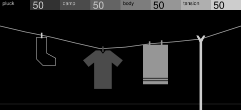

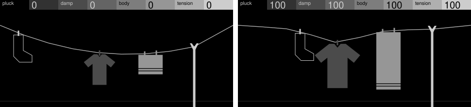

**Plucked string.** A line under tension, with a sock, shirt, towel and prop on it.

- **Knobs:** pluck slides the sock, damp weighs the shirt so the line dips, body
  lengthens the towel, tension raises the prop to pull the line straight.
- **Notes:** the line swings and settles, quicker as damp rises.
- **To borrow:** a line combined with flat shapes that hang on it.

## CD player

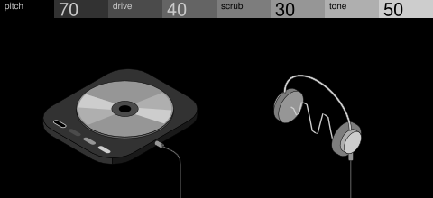

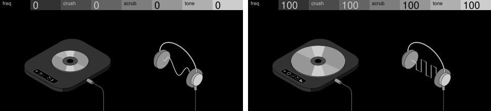

**Lo-fi digital oscillator.** An isometric deck playing into headphones, the wave
running between the pads; a small LCD carries the code as symbols.

- **Knobs:** freq sets the cycles between the pads, crush holds the wave in coarser
  steps, scrub turns the disc's light and slides the wave, tone adds a harmonic.
- **Notes:** the light spins and the wave scrolls, coasting to a stop after release.
- **To borrow:** a swap between two fixed sizes instead of scaling a 3D part.

## Blinds

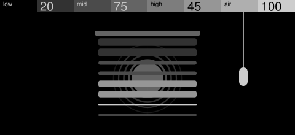

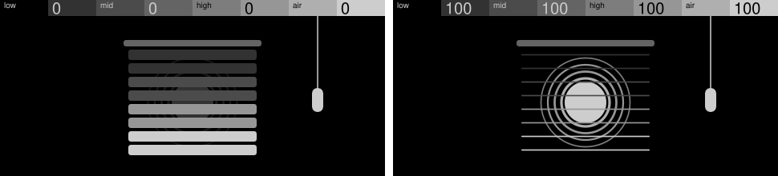

**Formant bank.** A blind of four slat pairs, dark to light, with a sun behind.

- **Knobs:** low, mid, high and air each tilt their pair open; the sun brightens as the
  blinds open.
- **Notes:** the cord tugs, the sun pulses and its rings step outward.
- **To borrow:** something hidden that the controls reveal.
- **Building it:** each slat pair is one outline, joined by a slit too thin to see.

## Sliding slabs

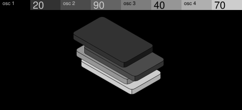

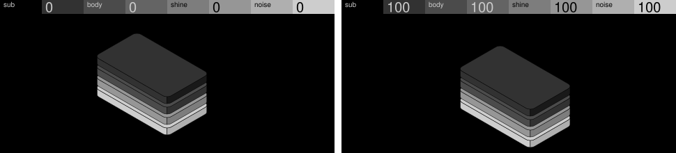

**Layered oscillator.** Four thin isometric slabs, dark to light, and nothing else.

- **Knobs:** sub, body, shine and noise each set their layer's level, sliding its slab
  further out.
- **Notes:** the gaps open a little and close as the note fades.
- **To borrow:** no subject at all, only layers shifted against each other.

## Wave and ball

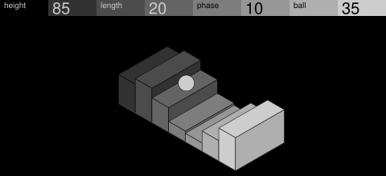

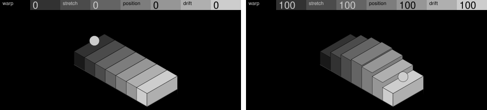

**Wavetable.** Isometric bars holding one wave, with a light ball on top.

- **Knobs:** warp and stretch shape the wave, position moves it along, drift rolls the
  ball.
- **Notes:** the wave travels along the bars, carrying the ball.
- **To borrow:** one round thing riding a field of straight ones.

## Turned form

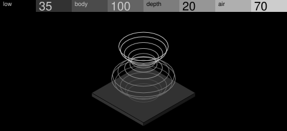

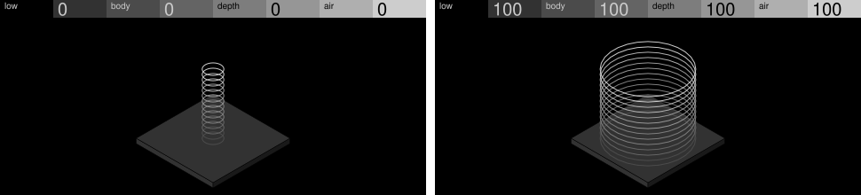

**Additive.** A turned vase of hairline rings whose profile is the spectrum.

- **Knobs:** low, body, depth and air each set the width at one height.
- **Notes:** the rings swell from the base up, like a pulse.
- **To borrow:** flat hairline rings may change size; the solid plate never moves.

## Cube ring

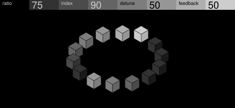

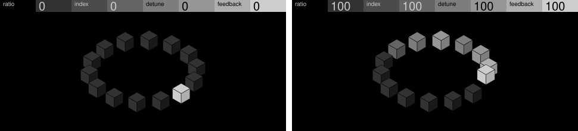

**FM pair.** A lit cube running round a ring of cubes, a fading tail behind it.

- **Knobs:** ratio moves the lit cube, index lengthens the tail, detune moves a second
  tail, feedback lifts the cube.
- **Notes:** the cube runs round the ring and coasts back after release.
- **To borrow:** a fade standing in for the grey code.

## Checkerboard

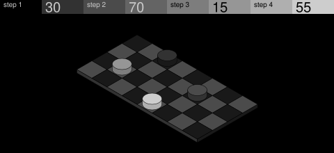

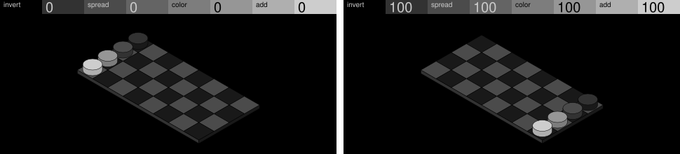

**Chord synth.** A checked board with a piece in each of four lanes.

- **Knobs:** invert, spread, color and add each move their piece along its lane, lifted
  and set down as if by an unseen hand.
- **Notes:** the pieces hop up together and land.
- **To borrow:** a step shown as a carried arc.

## Rotary phone

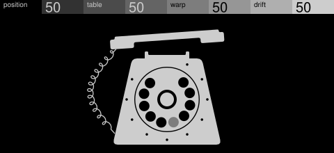

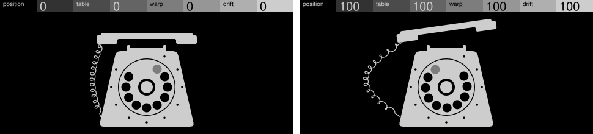

**Stepped wavetable.** A rounded silhouette, dots for numbers; dialling is choosing.

- **Knobs:** position turns the dial, table moves the grey mark to another hole, warp
  lifts the handset, drift swings the cord.
- **Notes:** the dial winds a little and runs back.
- **To borrow:** four different movements in place of the grey code.
- **Building it:** the coiled cord is one line in four pieces of 32 points.

## Music box

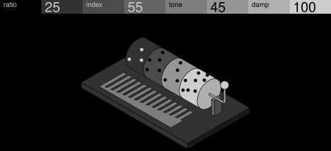

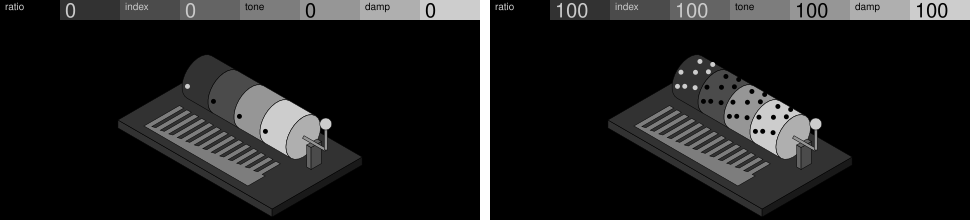

**Bell.** A pinned cylinder in four bands over a comb, with a crank.

- **Knobs:** ratio, index, tone and damp each add pins to their band. Pins are small,
  so check they read on a device.
- **Notes:** the cylinder and crank turn and the struck tooth flicks, bending
  move-or-copy: a music box that doesn't turn isn't playing.
- **To borrow:** the mechanism as the picture; a control that adds parts.

## Pendulums

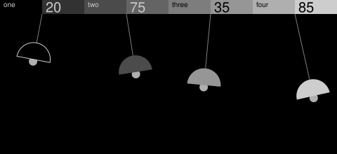

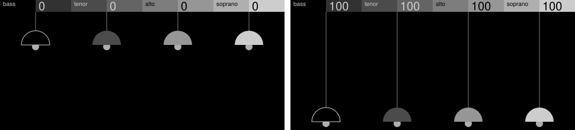

**Pad.** Four lamps hanging on rods from the header bar.

- **Knobs:** bass, tenor, alto and soprano each brighten one voice, lengthening its rod.
- **Notes:** the lamps swing, the longer ones slower, in and out of step.
- **To borrow:** the header bar as part of the scene.

## Barcode

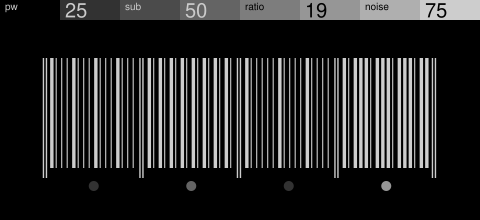

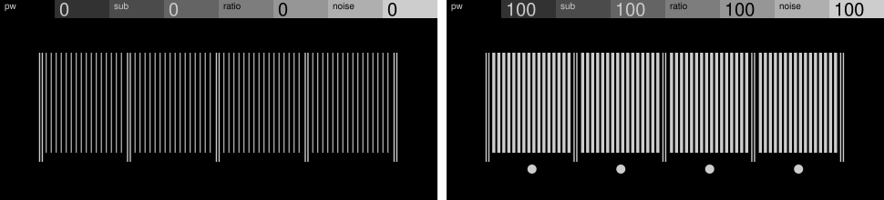

**Pulse oscillator.** Four sections of bars, with a dot under each that brightens.

- **Knobs:** pw, sub, ratio and noise each turn more of their section's bars wide.
- **Notes:** a scan passes along the bars, thickening each for a moment.
- **Building it:** each bar is a thin and a wide copy, one shown, one parked.

## Threshold

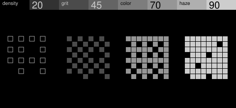

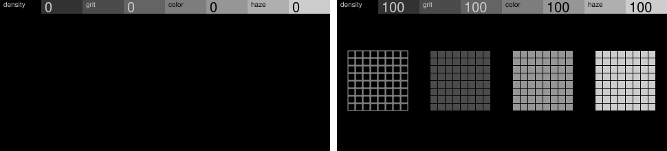

**Noise.** Four tiles of one ordered-dither map, hollow then dark to light.

- **Knobs:** density, grit, color and haze each fill their tile to a level.
- **Notes:** the levels lift for a moment, so the texture blooms and settles.
- **Building it:** 256 cells, so it declares `"sdk": "1.8"`.

## Split

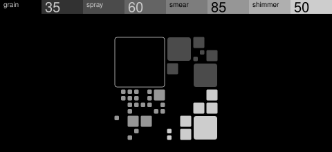

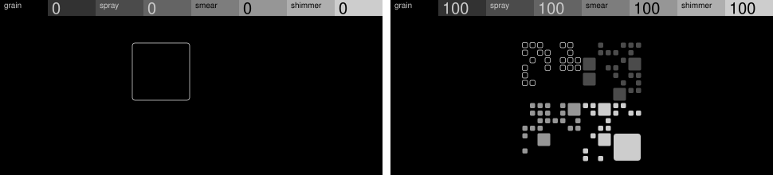

**Granular.** A square split into quarters again and again, shown as scattered tiles.

- **Knobs:** grain, spray, smear and shimmer each set how far their quarter divides.
- **Notes:** a few more tiles show for a moment, like activity on a chip.
- **Building it:** tiles never change size; each quarter moves or parks a set of each.

## Spokes

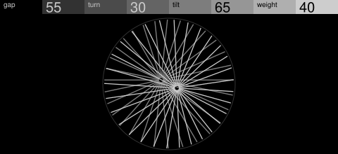

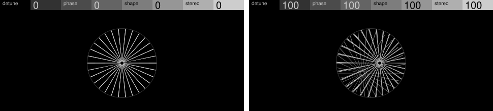

**Detuned pair.** Two fans of spokes whose overlap bends into bands, as close pitches
beat.

- **Knobs:** detune pulls the hubs apart, phase turns the light fan, shape drops the dim
  hub, stereo doubles the light spokes. At 0 they line up into one wheel.
- **Notes:** the fan kicks round a few degrees.
- **Building it:** each fan is two fixed half-fans that only move and turn.

## Truchet

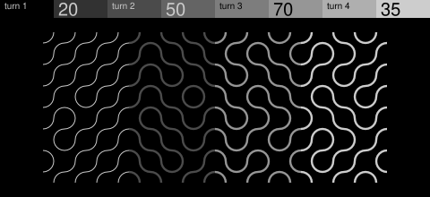

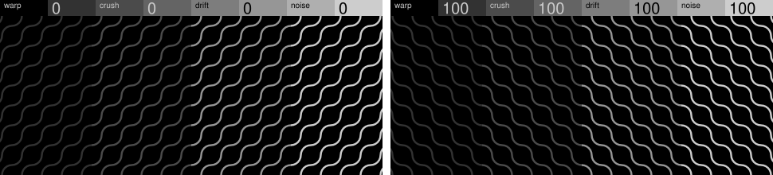

**Glitch oscillator.** Quarter-arc tiles, so rows of waves break into loops.

- **Knobs:** warp, crush, drift and noise each turn more of their column group's tiles.
- **Notes:** a few tiles turn at random.
- **Building it:** 320 nodes, so it declares `"sdk": "1.8"`.

## Gravel

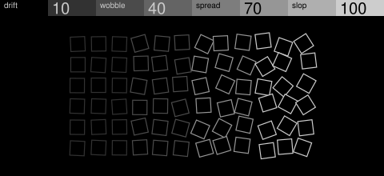

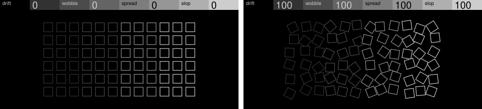

**Unstable oscillator.** A neat grid of hollow squares that loosens.

- **Knobs:** drift, wobble, spread and slop each loosen their column group.
- **Notes:** a column shakes loose for a moment.

## Halftone

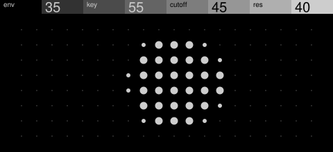

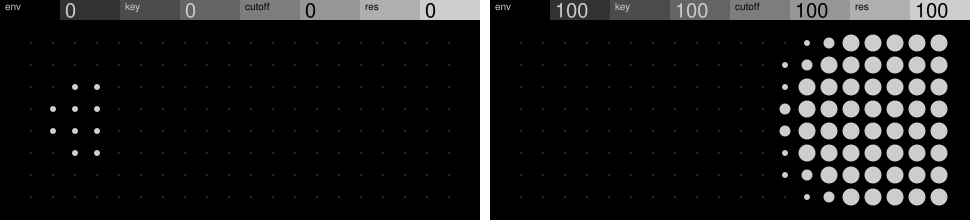

**Subtractive.** Tiny dim dots that swell into a soft light spot, the filter's opening.

- **Knobs:** env sets how big the middle dots grow, key moves the spot, cutoff sizes it,
  res sharpens its edge.
- **Notes:** the spot swells like a flash.
- **Building it:** dots come in four sizes, so a turn changes at most 24 of 160.

## How the examples compare

Most changed is the most nodes one 5% step of one control changes, from a script.
Peaks above 20 are fine while a control turns.

| Example | Way of drawing | Grey code | Nodes | Most changed |
| --- | --- | --- | --- | --- |
| Washing line | Line and flat shapes | Along the line | 21 | 20 |
| CD player | Isometric | LCD symbols | 38 | 6 |
| Blinds | Flat shapes | Slat pairs | 12 | 5 |
| Sliding slabs | Isometric | Whole slabs | 12 | 3 |
| Wave and ball | Isometric | Ramp, then the ball | 18 | 16 |
| Turned form | Isometric hairlines | Ramp up the stack | 17 | 8 |
| Cube ring | Isometric | Fade | 42 | 24 |
| Checkerboard | Isometric | Pieces | 42 | 2 |
| Rotary phone | Silhouette | Movement | 31 | 10 |
| Music box | Isometric | Bands | 47 | 1 |
| Pendulums | Flat shapes | Whole shades | 12 | 3 |
| Barcode | Field | Dots | 142 | 19 |
| Threshold | Field | Tiles | 256 | 4 |
| Split | Field | Quarters | 172 | 23 |
| Spokes | Field | None | 11 | 8 |
| Truchet | Field | Column groups | 320 | 12 |
| Gravel | Field | Column groups | 72 | 18 |
| Halftone | Field | None | 160 | 24 |
