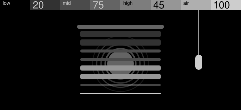
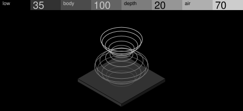

# Synth screens

How to draw a synth's own screen so it sits beside the stock engines. The way there is to
study the stock screens closely and draw your own subject the same way. The rest of this
page summarises what that study finds and gives original examples, but a summary is no
substitute for looking: the feel lives in sizes, weights and spacing that words lose.

The [display API](display.md) sets what a frame can draw and the
[UX conventions](ux.md) how every machine behaves. Work in grey unless the person making
the machine asks for colour, and then follow the
[colour design guidance](ux.md#color-design-guidance) in place of the grey code.

## Study the stock screens

**Look at them: the official guide.** The
[synth engines guide](https://teenage.engineering/guides/op-xy/synth-engines) shows every
engine's screen assembled, as it looks while running. Each picture is a drawing inside
the page, so it stays sharp when enlarged: zoom the browser in and take a screenshot of
each, or save the drawing under each engine's heading as an SVG file (dissolve's is an
image file). Keep them in a private folder outside every checkout, for looking only:
never copy them, their shapes or their paths into a machine. Draw your own subject.
Their greys are slightly tinted for the web; the measurements below give the real ones.

Look at all eight engines at 1:1 once, and check what you see against these
measurements. Then put the four closest to your idea beside each draft with the kit's
preview (`--stock` takes the saved screenshots as PNG or the drawings as SVG).

**Measured.** Size and place come from the official pictures on the 480 × 220 stage (the
header is y 0 to 20); greys and weights from the stock screen files on the device.

| Engine | Subject spans | Lit | Greys | Lines and outlines | Other sizes |
| --- | --- | --- | --- | --- | --- |
| Simple | x 129 to 342, y 46 to 204 | 18% | the whole ramp; step tops `323232` to `CDCDCD`, sides one step darker | 0.5 px black on every face; the spring is 0.5 px hairlines | 4 steps, about 40 parts |
| Prism | the ray crosses the full width; objects y 72 to 152 | 7% | `4B4B4B`, `969696`, `CDCDCD`; rays fade to `7D7D7D` and `4B4B4B` | every line 1 px | eye r 20; about 18 parts |
| Dissolve | the whole stage under the header | about 70% | black and `CDCDCD`, a few cells in `4B4B4B`, `7D7D7D` | none | 10 px cells |
| Hardsync | dryer x 59 to 160; the beam runs off the right edge; the cord off the bottom | 19% | dryer `CDCDCD`; beam the ramp `191919` to `CDCDCD` | dryer 1 px black; curve 1.4 px `CDCDCD`, its baseline 0.7 px | beam blocks 25 × 35; grille holes r 1.9; dots r 5 |
| Axis | x 157 to 388, y 51 to 215 | 12% | cubes `CDCDCD` fading to `191919` going back; dots `191919`, `4B4B4B`, `AFAFAF`, `CDCDCD` | 0.5 px black on every face; one 2 px `CDCDCD` line | cubes 30 × 35; dots r 5 |
| Epiano | x 157 to 323, y 51 to 209 | 16% | keys `CDCDCD` and black; plates `AFAFAF`, `7D7D7D`, `323232` | 0.5 px, `191919` on light faces and `CDCDCD` on black keys; plate grids 0.5 px | plates 20 px apart |
| Organ | columns x 35 to 445, hanging from the header to y 200 | 9% | numerals `CDCDCD`; tiles hollow, `4B4B4B`, `7D7D7D`, `CDCDCD` | 0.5 px `646464` rails | symbols about 20 px |
| Wavetable | the wave crosses the full width, y 67 to 177 | 4% | one light line | one line | — |

What they share: a subject 170 to 230 px wide, or a line or field that runs off the
edges; 4 to 19% of the stage lit; outlines 0.5 px, lines 1 to 1.4 px; detail cut in black
into a filled shape (hardsync's grille, epiano's grids), never drawn on top in a new
colour; and, except for organ hanging from the header, about 25 px clear under it.

**Digging deeper.** Every OP-XY holds its stock screen files in `content/display`. With
the OP-XY in file-transfer mode, the person making the machine can copy some to a
private folder (`python ../open-xy/sdk.py device pull content/display/hardsync.svg --out
~/opxy-stock/hardsync.svg`) to read exact shapes. These files are parts the OP-XY
assembles while running, so dissolve, wavetable, simple's slinky, axis's star and organ's
numerals look incomplete on their own. Never copy or commit them.

**How each looks and behaves:**

| Engine | How it looks | What a note does | What the knobs do |
| --- | --- | --- | --- |
| Simple | An isometric slinky on solid grey steps, the step tops coded `323232` to `CDCDCD`; four small squares beside it; static behind | The spring walks down the steps and the squares fly in and out while the sound plays, settling as it fades | shape, pw, noise, stereo; noise thickens the static |
| Prism | A line diagram: a ray split by a prism, through two lenses, into an eye in cross-section; objects coded left to right, split rays fading by rank | Each new note sends a beam to one object picked at random; it also follows the level | shape, ratio, detune, stereo; ratio and detune change distances, not greys |
| Dissolve | A field of 10 px static cells filling the stage under the header, in black, white and a few greys; nothing else | While the last note is held, random cells keep appearing; on release the static freezes | swarm, am, fm, detune; no knobs are drawn: each one changes the static's contrast and density |
| Hardsync | An uncoded hair dryer silhouette with a dot-ring grille, a stepped beam of eight blocks through the whole ramp, and a filter graph on a baseline | While any note is held the beam animates; on release it blends back to rest | freq, sub, noise, lowcut; the graph carries the code |
| Axis | One 30 × 35 px cube copied along three arms into a star, fading toward black going back, with four small coded dots | Nothing | tone, ratio, shape, tremolo; each moves one arm, easing there over a few frames |
| Epiano | An exploded isometric keyboard, black keys pitch black with light edges, over three plates 20 px apart, each darker | Each note presses a key down; some notes share a key | tone, texture, punch, tine |
| Wavetable | No artwork: only the current wave, drawn in code | The wave moves while a note plays, and with drift up it keeps moving without one | table, position, warp, drift |
| Organ | Four columns of numerals 8 to 1 over rounded tiles with drawn symbols, hollow then `4B4B4B`, `7D7D7D`, `CDCDCD` | Nothing | Shows no names; the official guide calls them type, bass, tremolo amount and tremolo speed |

**Borrow a look from one and a behaviour from another.** The behaviours are the easiest
part to reuse: one part lit at random per note (prism), a field that grows while a note
is held and freezes on release (dissolve), an animation that runs while any note is held
and blends back (hardsync), the object pressed by each note (epiano), motion that settles
as the sound dies (simple).

### Mixing ways of drawing

Most stock screens use one way of drawing; hardsync mixes three: a dryer silhouette, a
stepped beam for its air, and a filter graph on its own baseline. When a screen mixes,
its parts live side by side; they are not blended into one object:

- **Each part is whole on its own.** Each is drawn in one way, in its own area of the
  stage, and would still make sense if the others were gone. Hardsync's dryer sits on
  the left and its graph on its own baseline to the right; neither is drawn into the
  other.
- **Related by meaning, not by touching.** What ties the parts together is the sound,
  not a shared line or contact point. Don't grow one part out of another, share their
  outlines or merge them. A marimba could show its bars and tubes on the left and a
  separate ringing line on the right.
- **Any way of drawing.** The second part doesn't have to be a graph or readout: it can
  be a silhouette, an isometric object, a line diagram or a field.
- **Two or more is fine**, as hardsync has three, as long as each stays whole.
- **One heavy, one light.** A solid shape with something thin beside it, as hardsync's
  dryer and its 1 px graph.
- **The light part often carries the knobs.** Hardsync's dryer has no knob greys; the
  beam and graph change with the sound while the dryer stays recognisable.
- **Still restrained.** Together the parts light 4 to 19% of the stage.

## Designing a screen

Whether a person or an agent draws it, study first, then make one strong draft.

1. **Study the stock screens** as above.
2. **Picture first.** Think of a picture that would look great on this screen in the
   stock style and suits the sound, and let the knobs follow the picture: each moves a
   part the picture already has, rather than adding a part for each knob. Offer the
   person at least three such ideas, each a name, a sentence or two, and the stock
   screens it takes its look and its behaviour from, and let them choose. Hold each
   idea to [what the picture needs](#what-the-picture-needs) before offering it. An idea
   that [mixes ways](#mixing-ways-of-drawing) names each part, its way of drawing and the
   area of the stage it takes.
3. **Draft it** with the [screen kit](screen-kit.md), borrowing parts from the closest
   examples, and preview it beside the stock screens you studied (`--stock`). Fix what
   doesn't hold up next to them: size, weights, spacing, missing or floating parts. Then
   check it against [the reference sections](#checking-a-draft) and the kit's report.
   Spend the effort here; one draft made against the stock screens beats many rounds of
   polish.
4. **Show the person** the preview sheet. Where they want something changed, offer two
   or three versions of that spot on one [comparison sheet](screen-kit.md#compare-versions)
   and change only what they pick. Never hand over a screen they haven't seen.
5. Author `panel.svg.fragment` and `display.cpp` from the approved sketch, run
   `sdk.py test --machine`, and check the machine's frames against the sketch.
6. Check it on a device: at rest, playing, and at the heaviest setting.

**Where the usage goes.** Studying the stock screens is the best use of it. Keep the rest
lean: read only the closest examples' kit files, show sheets rather than describe them,
keep messages short, and write no display code until the sketch is approved.

### What the picture needs

These decide more than greys and weights do; hold every idea and draft to them.

- **An object, whole, from outside.** When the picture is an object, someone who hasn't
  heard the brief should name it at a glance. Draw the outside people know (an
  accordion's bellows between its ends), not its hidden workings (reed plates read as a
  circuit board). A picture needn't be an object, and a sound with no instrument
  needs none: a wave, a spiral, a rule or a field is a picture in its own right and
  needs no name (see [finding the idea](#finding-the-idea)).
- **Full size.** As big as stock's subjects, 170 to 230 px wide and centred (see
  [the measurements](#study-the-stock-screens)). A small subject on a big black stage
  looks unfinished.
- **One object, one hand.** Draw every part in the same view and the same treatment:
  the same outline weight, the same way of shading and stepping greys. Then it reads as
  one thing made of one material, not a set of parts.
- **The controls work the real parts.** Where you can, each control changes a part of
  the object the way the sound changes the instrument: a steel pan's skirt grows for
  boom and its stick tip hardens, as epiano's keys press and organ's drawbars pull. A
  part added to show a control must still make sense as part of the picture. Never
  trade the recognisable outside for hidden parts just to give each control a part of
  its own: a control may move, resize or regrey a visible part.
- **The instrument, not the player.** When a control is something the player does (a
  palm pressing, a breath, a damper pedal, a hand muting), show what it does to the
  instrument: the skin tightens or dents, the reeds open, the dampers lift off the bars,
  the strings go still. Never draw hands, arms, lips or bodies. A beater, bow or pick
  may appear only where it touches the part it plays.
- **Nothing floating.** Every part is attached where it really sits; a block, pedal or
  pick hovering beside the object to carry a knob reads as a mistake.
- **Round objects in line art.** A round object with many parts, such as a kettle drum,
  a steel pan or a bowl with its fittings, falls flat built from solid isometric faces:
  draw it at the same angle in line art, thin light outlines over dark or black fills,
  as drumline's fm screen does. Keep solid isometric for boxes, bars, keys and slabs
  (simple, epiano, axis).

### Hard limits

The SDK's, so every machine keeps them, however busy a stock screen gets.

- **Four changing shapes.** A machine can redraw the outline of at most four shapes,
  each made of up to 64 points within 64 px of its centre: a box 128 px square, or 256
  with the shape scaled to twice its size. Every other shape keeps the outline it was
  drawn with, at any size: it can only move, turn, grow or shrink as a whole, or change
  grey. This is the SDK's budget, not the look: stock screens aren't
  bound by it, and dissolve and simple paint their static straight to the screen, which
  machines can't.
- 256 nodes, or 512 with `"sdk": "1.8"`.
- About 20 nodes change a frame while notes sound, and an idle screen is still, as the
  [UX conventions](ux.md#screens) ask.

### Stock tendencies

Good defaults rather than rules: Teenage Engineering drew each stock screen by hand for
its own sound, and the screens named here break them.

- Each control changes the picture visibly at 0, 50 and 100, usually by moving a part of
  its own. Dissolve's static and hardsync's beam answer all four at once.
- Parts take their encoder's grey, in encoder order. Hardsync, axis and dissolve don't.
- Each control is [named](#naming-the-controls) in one lowercase word for what it does.
- A note sets something moving and an idle screen holds still. Axis and organ ignore
  notes; wavetable keeps drifting with no note while drift is up.
- 3D parts only move or repeat, and solid ones carry a 0.5 px outline.
- No words in the drawing (organ's drawbars carry numerals); no gradients, soft shadows
  or perspective.

Bend one where it suits the sound or gives a fun animation, such as a 3D part that
spins or a shape that breaks out of the frame. Know which tendency you are bending and
keep the rest, so the bend reads as a choice.

### Out of character

These never look like the OP-XY, whatever the sound:

- **No scattered dirt.** Specks, scratches, dust and crackle sprinkled over the picture
  read as noise. Stock texture is a whole field of even cells, as on dissolve, or none.
- **No borrowed era or genre.** Pixel art, chunky 8-bit blocks, LCD or scope windows and
  VU meters belong to other devices. A wave or spectrum is fine; the window, bezel and
  grid around it are not. Draw the idea in the stock greys and weights, not in the look
  of where it comes from.
- **No frames.** Stock draws straight onto black, with no box or bezel around the
  picture.
- **No people.** Stock draws the object, never the player: no hands, fingers, lips or
  bodies.

These are examples, not the whole rule: a screen can avoid all four and still look out
of character. When in doubt, put it beside the stock screens and look.

## Checking a draft

Everything from here on is the stock look written down: what studying the stock screens
finds, in words and numbers, and the tricks the examples use. Read it after you've
looked at the stock screens and made a draft, to check that draft, not before drawing;
read first, it gets drawn from instead of the screens. The kit's report flags the parts
it can measure: greys, outlines, the space under the header, changes too small to see.

## Principles

These refine [what the picture needs](#what-the-picture-needs).

- **Less around it, never less of it.** One idea, drawn plainly: cut what sits around
  the subject (extra objects, numbers, decoration), not the parts that make it itself.
  *Taste:* if more than about a fifth of the stage is lit, take something away from
  around the subject; never decorate the emptiness with grids or frames.
- **But it has to read.** Plain is not bare: stock keeps the parts that make a thing
  itself, as the dryer keeps its grille dots, epiano every key and simple every coil of
  the slinky. If a draft has become a few floating bars and lines, give the subject back
  its recognisable parts before cutting anything else. Complex subjects (a cello, a drum
  kit) need more of their parts than simple ones (a bell, wind). Draw the giveaway
  detail in full: every note dimple on a steel pan, not a token few.
- **It moves when it sounds,** as the real object would.
- **Borrow parts, not screens.** A stock screen with its nouns swapped is still a copy.

## The grey is the knob

The encoders run from dark grey to white, and several stock screens use that order as a
code: **a part's grey says which encoder moves it.** It's one use of grey among several:
axis spends its greys on depth, prism fades its rays by rank, and hardsync's mid grey
knob brightens a white circle.

| Stock screen | Encoder 1 | Encoder 2 | Encoder 3 | Encoder 4 |
| --- | --- | --- | --- | --- |
| prism: objects, left to right |  outline |  `4B4B4B` |  `969696` |  `CDCDCD` |
| organ: tiles |  outline |  `4B4B4B` |  `7D7D7D` |  `CDCDCD` |
| axis: dots |  `191919` |  `4B4B4B` |  `AFAFAF` |  `CDCDCD` |
| simple: step tops |  `323232` |  `4B4B4B` |  `969696` |  `CDCDCD` |
| chord, arpeggio: tiles |  `191919` |  `4B4B4B` |  `969696` |  `CDCDCD` |
| master distortion: fader caps |  outline |  `323232` |  `969696` |  `CDCDCD` |

- **The four greys:** `191919`, `4B4B4B`, `969696` and `CDCDCD`. Encoder 1's part may
  instead go hollow with a thin light outline, or take `323232`. A solid 3D part takes
  `323232`; a part that is only lines goes light, since a dark line vanishes on black.
- **Order:** left to right, or dark to light along the subject, as down a staircase.
- **Where:** on the parts the controls move. On a single object keep it to small
  accents, as axis's four dots, or give it to a companion, as hardsync's graph.
- **Other greys are free** for whatever belongs to no encoder. A part keeps its grey
  while it moves.

## Naming the controls

The header shows each control's name above its value, the only word on a synth screen.

- **One lowercase word,** mostly three to six letters, never more than eight. No numbers,
  units or capitals; abbreviations only where usual: pw, am, fm, freq, lowcut.
- **Name what you hear, never the slot:** no f1, osc 2 or step 3.
- **Reuse stock's word for the same job:** shape, ratio, detune, stereo, noise and tone
  mean the same on every engine that has them.
- **The keys set the pitch,** so no synth has a pitch control; one that moves the
  oscillator against the note is freq, as on hardsync.
- **The envelope sets the length,** so no synth has an attack, decay, release or note
  length control: the OP-XY's envelope page already does that for every engine.

| Kind | Stock names | Use it when |
| --- | --- | --- |
| Sound term | shape, ratio, detune, stereo, pw, sub, lowcut, warp, drift | the control does a familiar job |
| Character | tone, texture, punch, color, contour, spread | it changes the sound's character |
| The source's part | tine, snare, slap, shake, ring, strike | the word can tie to the drawing |
| Play | swarm, mush, era | one word says it better; at most one per engine |

## Finding the idea

*Taste:* stock finds its ideas five ways.

- **An ordinary thing with a sideways link:** hard sync is a hair dryer, simple a slinky
  on a staircase. If the link fits in one sentence, it's enough.
- **The instrument's own mechanism,** where it shows: organ's drawbars, epiano's
  exploded keys.
- **A rule that stands for nothing:** dissolve's static.
- **A rule that echoes something real:** hardsync's stepped beam reads as the dryer's
  air without drawing any. Stop well before it becomes a picture.
- **The sound itself:** wavetable draws only its wave, and hardsync's graph shows its
  filter.

It needs something each of the four controls can change, and something that answers a
note: a part, a line, a mark or the whole picture.

## The ways of drawing

Most stock screens use one; mixed parts each stay whole in their own area, as on
hardsync (see [Mixing ways of drawing](#mixing-ways-of-drawing)).

### Silhouette

Hardsync's dryer. One `CDCDCD` solid about 150 to 165 px tall, side-on or dead-front,
rounded at nearly every edge, with detail knocked out in black: cuts of about 1.4 px,
holes, grilles of dots. Reduced to circles it stops being the thing; with every curve it
becomes clip art.

### Isometric

Simple, epiano, axis.

- 30° edges, no vanishing point; heroes about 130 to 210 px wide.
- Boxes, slabs, cylinders and plates assembled into a staircase, a stack, a star.
- **Solid for straight things, line art for round ones.** Boxes, bars, keys and slabs
  are solid; a round object with many parts is drawn at the same angle in
  line art (see [what the picture needs](#what-the-picture-needs)).
- **Abstract only on purpose.** Abstract 3D shapes are fine when being abstract is the
  point, as axis's star of cubes is; on an object every block is a real part.
- **Move or copy:** a 3D part slides or repeats but doesn't turn or grow. Flat marks and
  hairlines on it may.
- Solid parts: top and left faces in the base grey, the right face one step darker;
  every face gets a 0.5 px black outline, and a pitch black part a `CDCDCD` one. Line
  art takes its thin light outline instead.
- Depth by even gaps (epiano's plates sit 20 px apart), by fading toward black (axis),
  or by a stepped shadow.

### Line diagram

Prism's rays, hardsync's curve. One weight, 1 to 1.4 px, sharp joints, `969696` to
`CDCDCD` for the line and `323232` for a baseline. Rank parallel lines by grey, mark
ends with rounded-square handles 5 to 7 px wide, and fill under a curve with 45° hatching
about 4 px apart, never a solid. A line diagram may be flat or drawn in depth, straight
or round.

### Field

Dissolve's static, hardsync's beam: a surface of repeated parts made by a rule, such as
dither, a quadtree or turning tiles. Cells that add up to an image read as pixel art.
Give each cell a fixed random number and compare it with the control, so a control says
how much and never which, without flicker. Code it by region, prefer coarse blocks, and
let notes lift a level or turn a few tiles.

## Shapes and layout

- **Corners follow the object:** bars and blocks stay sharp, round things are round.
- **One fill per shape,** black the only second colour. On a solid shape, black gaps
  separate parts and detail is cut in black; don't trace a solid grey shape with a
  lighter border. Line art is the other way of drawing an object, thin light outlines
  over dark or black fills: pick one per object.
- **Symbols, not words:** about 20 px across, as organ's, on a tile with 3.3 px corners.
- **Placement:** see [the measurements](#study-the-stock-screens); with the two-page
  header, leave 38 px clear.

## How it should move

- **Notes.** Keep a `NoteTracker` in the display state and animate from `hold_started`
  while `held_notes` is nonzero, releasing on `hold_ended`, as dissolve, epiano and
  hardsync animate while a note is held.
- **The tail.** Simple and prism settle as the sound dies. The SDK doesn't pass the
  level, so time the settle from the amp envelope (`input.amp`, SDK 1.10), whose release
  word runs backwards: larger is shorter.
- **Controls.** Redraw from the four values, p-locks included. Ease to a new value in
  0.15 to 0.2 s, as the [UX conventions](ux.md#motion) ask, and jump with reduced motion
  or on a track change.
- **Like the object, deadpan.** A dial turns, a cord swings and dies away. Nothing
  overshoots, squashes or sparkles.
- **Only what must move,** and nothing between notes.

## Building it within the limits

The [display API](display.md#declaration) has the numbers; these are the tricks the
examples use to keep to the [hard limits](#hard-limits).

- **Copies instead of reshaping:** a part that changes size becomes fixed copies, one
  shown and the rest parked off screen (Barcode, Split).
- **Join what changes together** into one outline (Blinds' slat pairs).
- **A box is three faces** that slide together; where a neighbour hides a face, draw the
  silhouette in the side grey under a lit top. Draw bottom up and back to front.
- **Lines are ribbons:** thin closed outlines with every point distinct, a long one cut
  into pieces that share end points. See
  [drawing on the device](display.md#drawing-on-the-device).

## The examples

Original screens drawn after studying the stock ones, each for a different kind of sound.
Borrow their parts and tricks; the stock screens stay the reference. Each is also a
[screen kit](screen-kit.md) file; [their write-ups](synth-screen-examples.md) show every control at 0
and at 100.

| | | |
| --- | --- | --- |
|  [Washing line](synth-screen-examples.md#washing-line): plucked string |  [CD player](synth-screen-examples.md#cd-player): lo-fi digital |  [Blinds](synth-screen-examples.md#blinds): formant bank |
|  [Sliding slabs](synth-screen-examples.md#sliding-slabs): layered oscillator |  [Wave and ball](synth-screen-examples.md#wave-and-ball): wavetable |  [Turned form](synth-screen-examples.md#turned-form): additive |
|  [Cube ring](synth-screen-examples.md#cube-ring): FM pair |  [Checkerboard](synth-screen-examples.md#checkerboard): chord synth |  [Rotary phone](synth-screen-examples.md#rotary-phone): stepped wavetable |
|  [Music box](synth-screen-examples.md#music-box): bell |  [Pendulums](synth-screen-examples.md#pendulums): pad |  [Barcode](synth-screen-examples.md#barcode): pulse oscillator |
|  [Threshold](synth-screen-examples.md#threshold): noise |  [Split](synth-screen-examples.md#split): granular |  [Spokes](synth-screen-examples.md#spokes): detuned pair |
|  [Truchet](synth-screen-examples.md#truchet): glitch oscillator |  [Gravel](synth-screen-examples.md#gravel): unstable oscillator |  [Halftone](synth-screen-examples.md#halftone): subtractive |
