# Synth screens

Art direction for a synth's own screen, so it sits beside the stock engines. It
describes what stock OS 1.2.1's screens do, from their artwork, their draw code and the
renders in the official
[synth engines guide](https://teenage.engineering/guides/op-xy/synth-engines), and shows
original examples that follow it. Anything marked *taste* is judgment rather than
measurement. Draw your own subject: stock artwork never goes in a machine.

The [display API](display.md) is the contract for what a frame can draw, and the
[UX conventions](ux.md) say how every machine behaves; this page is the default look
within them. A machine that wants colour follows the
[colour design guidance](ux.md#color-design-guidance) instead of the grey code here.

## Designing a screen

Whether a person or an agent draws it, design the screen in words before drawing it:

1. Read the principles and the stock engines.
2. **Offer at least three options.** Write down three or more different screens for the
   sound, each a different idea and preferably a different
   [way of drawing](#the-ways-of-drawing): one an ordinary thing, one the instrument's
   own mechanism, one a rule field, for example. Give each in the fields the examples
   use: subject, drawing, grey code, what each control moves, what a note does. Check
   them against the list below, and let the person making the machine choose before
   anything is drawn.
3. Plan the chosen screen's cost: which parts reshape (four at most), how many nodes,
   and how many change when a control turns or a note plays.
4. Author `panel.svg.fragment` and `display.cpp`, run `sdk.py test --machine`, and look
   at every control at 0, 50 and 100 at 1:1.
5. Check it on a device: at rest, playing, and at the heaviest setting.

**Before building, check that:**

- There's one subject, with at most one companion.
- Each control moves a different part in a different way, visibly at 0, 50 and 100, and
  roughly in proportion to what it does to the sound.
- The parts take the code greys in encoder order, with encoder 1 hollow where it sits on
  black.
- Something moves while a note is held and settles after it; at rest, nothing moves.
- Flat shapes are rounded with one fill, edges are black cuts, and the drawing carries no
  letters, numerals, gradients, shadows or perspective.
- 3D parts only move or repeat; they never turn or change size.
- At most four outlines reshape, and about 20 nodes change a frame on average while
  notes sound.

## Principles

- **Less.** Stock screens are sparse: one idea, drawn plainly, on a mostly black stage.
  When a drawing is done, ask what can be removed, and remove it.
- **The grey is the knob.** A part's grey says which encoder moves it.
- **Something moves whenever it sounds.** Notes move the screen, not only the encoders.
- **Borrow parts, not screens.** The parts described here can be recombined freely, and
  a new idea built from them is welcome. A whole stock screen with its nouns swapped
  still looks like a copy.

## The grey is the knob

The OP-XY's encoders run from dark grey to white, and the stock screens use that order
as a colour code: **a part's grey says which encoder it belongs to**. It doesn't mean
light, distance or importance. This is the most important idea in the look.

| Stock screen | Encoder 1 | Encoder 2 | Encoder 3 | Encoder 4 |
| --- | --- | --- | --- | --- |
| prism: objects, left to right | outline | `4B4B4B` | `969696` | `CDCDCD` |
| organ: tiles | outline | `4B4B4B` | `7D7D7D` | `CDCDCD` |
| dissolve: knobs | `191919` | `646464` | `AFAFAF` | `CDCDCD` |
| axis: dots | `191919` | `4B4B4B` | `AFAFAF` | `CDCDCD` |
| simple: step tops | `323232` | `4B4B4B` | `969696` | `CDCDCD` |
| chord, arpeggio: tiles | `191919` | `4B4B4B` | `969696` | `CDCDCD` |
| master distortion: fader caps | outline | `323232` | `969696` | `CDCDCD` |

- Use `191919`, `4B4B4B`, `969696` and `CDCDCD`. Where encoder 1's part sits on black,
  draw it hollow with a thin `CDCDCD` outline, as prism and organ do.
- Place the four parts left to right in encoder order. Where the subject has its own
  direction, such as a staircase or a stack, run dark to light along it.
- When the subject is one object, keep the code as small accents: dissolve gives its
  four knobs the four greys. A row of four status dots, about 5 px in radius, works
  anywhere.
- Where the hero can't carry the code, give it to a companion: hardsync's hair dryer is
  one light silhouette, and the filter graph beside it carries the code.
- Other greys are free for what belongs to no encoder, such as side faces and
  baselines. A part keeps its grey while it moves.

## Finding the idea

*Taste:* stock finds its ideas four ways.

- **An ordinary thing with a sideways link to the sound.** Hard sync is a hair dryer;
  simple is a slinky on a staircase. The thing rhymes with the synthesis rather than
  explaining it. If you can say why in one sentence, it's enough.
- **The instrument's own mechanism, taken literally.** Organ is drawbars. Epiano is an
  exploded view of keys over their plates.
- **A rule, standing for nothing.** Dissolve's squares aren't a picture of anything:
  they're static.
- **A rule that echoes something real.** A rule that happens to look roughly like a real
  object or graph, without drawing it: the split field reads as a close-up of a chip, the
  barcode as a barcode. Lean toward the resemblance a little, and stop well before it
  becomes a picture.

Whichever you pick, give it parts that can do what the four controls do, and something
for a note to set moving.

## The ways of drawing

Pick one, plus at most one companion, as hardsync pairs a silhouette with a line graph.

### Silhouette

Hardsync's dryer, the hand on the hold tile.

- Side-on or dead-front, never three-quarter.
- One flat solid in `CDCDCD`, corners rounded, about 150 to 165 px tall as the hero.
- All detail is knocked out in black, as black shapes drawn on top: cuts of about
  1.4 px, holes, grilles. Hardsync's grille is just rings of dots.
- Keep the thing recognisable: the dryer has a true handle and grille yet stays flat.
  Reduced to circles and bars it stops being the thing; with every curve drawn it
  becomes clip art.

### Isometric

Simple, epiano, axis, the arpeggio's bars, the master EQ's floor.

- Edges at 30° (about 4 px up for every 7 px across), with no vanishing point.
- **Primitives, not models.** Boxes, slabs, cylinders and plates, assembled into a
  structure: a staircase, a stack of plates, a star of cubes. **Or detailed line art:**
  the same shapes drawn entirely in fine lines, as drumline's FM page does.
- **Move or copy, never turn or scale.** A 3D part slides or is repeated, but never
  rotates or changes size; stock's isometric parts only translate. It keeps the drawing
  honest and avoids the hard part of animating 3D: a sliding block or a stack of copies
  stands in for anything that would swing, spin or grow. Flat shapes lying on a 3D
  object, like a highlight, may still turn.
- Top and left faces share the base grey; the right face is one ramp step darker, as
  simple's steps go from `CDCDCD` to `AFAFAF`. A 0.5 px black seam separates parts of
  similar grey.
- Explode layers with even gaps: epiano's plates sit exactly 20 px apart. Fade depth
  into black, as axis's cubes dim as they go back.
- Lay hairlines over solids: simple's spring is thin hollow ellipses on solid steps.
  Keep thin grids at least 3 px apart.
- Keep it modest: stock's isometric heroes are about 130 to 210 px wide.

### Line diagram

Prism's rays, hardsync's curve, the envelope pages.

- One weight, 1 to 1.4 px, with sharp joints: `969696` to `CDCDCD` for the line,
  `323232` for a baseline beneath it.
- Rank parallel lines by grey, as prism fades its split rays from `CDCDCD` to `4B4B4B`.
- Mark ends and bends with rounded-square handles 5 to 7 px wide.
- Fill under a curve with hatching rather than a solid, as the filter envelope does:
  1 px lines at 45°, about 4 px apart, in one mid grey.

### Pattern field

Delay's stripes, dissolve's cells, hardsync's stepped beam.

- Hard blocks, no soft edges, in one or two greys or a single ramp. Hardsync's beam is
  eight 25 × 35 px blocks.
- Dissolve draws its 10 px cells straight into the framebuffer, which machines can't.
  With nodes and about 20 changes a frame, use bands, stripes and coarse blocks that
  change a few at a time.

### Rule field

Dissolve's static, taken further: a pattern made by a rule. See the [rule fields](#rule-fields) below.

- **A rule, not a picture.** Dither, a quadtree, tiles that turn, a loosening grid.
  Cells that add up to a picture read as pixel art.
- **Decide each part once.** Give every cell a fixed random number and compare it with
  the control, so a control says how much and never which. Turning it only adds or
  removes the same parts in the same order, without flicker.
- **Let notes play it.** A note can lift a level, turn a few tiles or sweep the bands for
  a moment, then let them settle.
- **The code still works** where the field divides into four, as rows, tiles or quarters.
  Thin lines can't show `191919`, so a field of lines may drop it.
- **Watch the cost.** Parts move, turn or scale only as wholes, so a field of lines that
  grow and shrink can't be built. Use fewer, larger parts, or change only on notes.

*Taste:* rule fields suit generated screens well: there's no object to get right,
only a rule.

### Sample strip

Sampler and drumline: the sound's own material, laid out as a page.

- A thin strip across the top, in place of the stepped header, holds the waveform as one
  light line, with small symbols at its ends for what the controls set.
- Below it, a large rounded `323232` panel holds the main view, with small tiles at its
  edge for channels or modes. The code moves to the symbols and tiles.
- Use it when seeing the material is the point. A sample engine's own screen can read
  its sample through `opxy_sample_overview()` (SDK 1.8).

## Shapes and layout

- **Flat shapes are rounded and have one fill.** No sharp corners on a flat solid, and no
  second colour inside it except black cuts. Pattern-field blocks tile, so they stay
  square.
- **Outlines are negative.** Parts are separated and detailed by black gaps and cuts,
  never by a light or grey line around a filled shape. A light line is only ever a shape
  of its own: a hollow part, a hairline, a graph.
- **Abstract means a system.** Axis is one cube repeated along three lines. Pick one
  small unit and one rule, and let the controls change the rule.
- **Mix one solid with one fine thing.** A solid dryer and a thin curve, solid steps and a
  wire spring.
- **Symbols, not words.** Titles and values belong in the header. The drawing carries no
  letters, numerals, captions, arrows or legends; where a part needs a label, give it a
  symbol about 20 px across, as organ's tiles do with a sine wave, a bass clef, a zigzag
  and a clock, on a tile with 3.3 px corners if it needs a ground.
- **Place it.** Leave about 30 px clear under the header (38 px with the two-page
  header). Centre the hero near x = 240, y = 130, or space parts evenly across the
  width. A ray or band crosses the whole screen from left to right; objects stay whole
  and inside the frame. Snap sizes and spacing to 5 or 10 px where the object allows.
- **Mostly black.** *Taste:* if more than about half the stage is lit, take something
  away. Don't decorate the emptiness: no dot grids, frames, corner marks or scanlines.
- **What stock never does:** perspective or three-quarter views, gradients, glows, drop
  shadows, transparency (hatching stands in), grey shading across a shape, light
  outlines around filled shapes, or colour on a synth screen.

## How it should move

From stock's draw code, then how to do the same with the SDK's
[display input](display.md#input).

- **Stock follows notes through the key.** Prism, dissolve, epiano and hardsync watch the
  held-note map that lights the keyboard. Each new note in prism sends a beam to one of
  its objects, picked at random. Dissolve and epiano animate while the last note played
  is held; hardsync animates its beam while any note is held.
- **And through the sound.** Simple and prism also follow the track's live output level,
  so they keep moving through the release tail and settle as the sound dies away.
- **Do the same with the SDK.** Keep a `NoteTracker` in the display state: animate from
  `hold_started` while `held_notes` is nonzero, and release on `hold_ended`. The SDK
  doesn't pass the output level, so time the settle from the track's amp envelope
  (`input.amp`, SDK 1.10). Its release word runs backwards: a larger value is a shorter
  release. A drum kit's voices ignore the envelope, so a kit's screen shouldn't follow
  it. The note serial counts per track, not per key.
- **Controls show as they turn.** Stock's screens redraw from the four values every
  frame, including sequencer p-locks while a pattern plays, but not the LFO. Ease to a
  new value within 0.15 to 0.2 s, as the [UX conventions](ux.md#motion) ask, and jump
  straight there with reduced motion or on a track change.
- **Like the object would.** A dial turns, a cord swings, a tile slides by one step.
- **Deadpan.** Nothing bounces, sparkles or squashes. The object does its job and stops.
- **Still at rest.** With no note and no turn, nothing changes. Move only the parts that
  need to; the rest of the picture costs nothing.

## Building it within the limits

The numbers are in the [display API](display.md#declaration); these are the
consequences for a drawing.

- **Four outlines can reshape.** Everything else is a node that moves, turns or scales
  uniformly as a whole, so a towel or a pull cord that changes length is a reshaping
  outline. Each has at most 64 points, within 64 px of its origin.
- **Nodes:** up to 256, or 512 on SDK 1.8. The redraw is the real cost: aim for about
  20 changed nodes a frame on average while notes sound, and none at rest.
- **Long lines become segments.** The washing line is too long for one outline, so it's
  eight straight pieces. Parts that touch can land apart on the device, so give parts
  that meet one outline or a shared origin.
- **Isometric sliding is cheap.** A box is three faces that move together. Getting the
  overlaps right is the work, so draw from the bottom up and from the back forward.
- **A black mask can trim a shape.** The wave's bars rise and fall without reshaping,
  their feet hidden by a black shape under the base.
- **Park what you don't need.** The music box's pins all exist from the start; the ones
  not showing are hidden off screen.
- **Lines are ribbons.** An outline must enclose area, so a line is a thin closed ribbon
  with every point distinct. See [drawing on the device](display.md#drawing-on-the-device)
  for what else the device draws differently.

## Stock engines

The best references for a new engine: their drawing, animation and code are better than
any example further down, so start here. Controls are named as in the
[official guide](https://teenage.engineering/guides/op-xy/synth-engines); behaviour comes
from stock 1.2.1's draw code. Look at the official renders alongside.

### Simple

**Basic oscillator.** A slinky walking down a staircase.

- **Drawing:** isometric: solid grey steps with a spring of thin hollow ellipses on them,
  four small squares floating beside it, over a field of static.
- **Grey code:** the step tops, `323232` to `CDCDCD` down the stairs.
- **Controls:** shape, pw, noise and stereo. Noise sets how dense the background static
  is.
- **Notes:** through the sound: the spring goes down the stairs and the squares fly in and
  out to support it while the sound plays, settling as it fades.
- **To borrow:** hairline against solid; a background texture that a control thickens.

### Prism

**Two oscillators, shape and ratio.** An optics lesson that ends in an eye.

- **Drawing:** line diagram with flat objects: a ray enters from the left, splits through a
  prism, passes a convex and a concave lens and ends at an eye drawn in cross-section,
  which can squint.
- **Grey code:** the objects left to right, hollow prism then `4B4B4B`, `969696` and
  `CDCDCD`; the split rays fade from `CDCDCD` through `7D7D7D` to `4B4B4B`.
- **Controls:** shape, ratio, detune and stereo. Turning any of them restarts the beam.
- **Notes:** both ways. Each new note sends a beam to one object, picked at random, and the
  screen also follows the track's level.
- **To borrow:** a signal crossing the whole screen; one random choice per note, so
  repeated notes never look the same.

### Dissolve

**Noise-modulated oscillators.** Random static, with four knobs.

- **Drawing:** pattern field of 10 px cells beside four split-disc knobs.
- **Grey code:** the knobs, `191919`, `646464`, `AFAFAF` and `CDCDCD`.
- **Controls:** swarm, AM, FM and detune; each knob turns with its control.
- **Notes:** while the note last played is held, a timer keeps adding random cells; on
  release the static freezes.
- **To borrow:** a field that changes only while a note is held; four knobs as the code
  beside an abstract field.

### Hardsync

**Hard-synced oscillator.** A hair dryer, with its filter beside it.

- **Drawing:** a light silhouette of a hair dryer with a grille of dot rings, a stepped beam
  of eight blocks running through the whole ramp, and a filter curve on a baseline with
  two status dots.
- **Grey code:** the dryer is uncoded; the graph carries it.
- **Controls:** frequency, sub, noise and lowcut. Sub sets how strongly the idle colours
  blend.
- **Notes:** while any note on the track is held, the beam animates; when all are
  released it blends back to rest.
- **To borrow:** an uncoded hero with a coded companion; a beam of blocks.

### Axis

**Two-operator FM.** A star of small cubes along three axes.

- **Drawing:** isometric: one small cube repeated along three lines, dimming through the
  ramp as they go back.
- **Grey code:** the dots, `191919`, `4B4B4B`, `AFAFAF` and `CDCDCD`.
- **Controls:** tone, ratio, shape and tremolo. Each value eases toward a new setting over
  a few frames, and part of the drawing oscillates on its own.
- **To borrow:** one unit and one rule; depth shown by fading, not size.

### Epiano

**Electric piano.** An exploded view of keys over the plates beneath them.

- **Drawing:** isometric: a short keyboard, black keys with thin light edges, over thin
  plates with fine grids, stacked exactly 20 px apart.
- **Grey code:** carried by the plates and two small knobs.
- **Controls:** tone, texture, punch and tine.
- **Notes:** animates while the note last played is held.
- **To borrow:** the instrument's own mechanism, taken apart; even gaps between layers.

### Wavetable

**Wavetable.** The wave itself.

- **Drawing:** no artwork: the screen is drawn entirely in code, as the current table's
  waveform.
- **Controls:** table, position, warp and drift.
- **To borrow:** when the sound's own shape is the clearest picture, draw that.

### Organ

**Organ.** Four tiles, each with a symbol.

- **Drawing:** a row of four rounded tiles across the top, each holding a small drawn
  symbol, with almost nothing else.
- **Grey code:** the tiles, hollow then `4B4B4B`, `7D7D7D` and `CDCDCD`.
- **Controls:** type, bass, tremolo amount and tremolo speed.
- **Notes:** none: the one synth screen that doesn't move with notes.
- **To borrow:** symbols in place of words. Not its stillness: it works on Teenage
  Engineering's touch, which a new screen won't have.

### Sampler and drumline

**Sample playback.** The sound's own material, laid out as a page.

- **Drawing:** the sample strip: the waveform as a light line across the top with small
  symbols at its ends, over a large rounded `323232` panel with channel tiles at its edge.
- **Grey code:** moves to the symbols and tiles.
- **To borrow:** a layout for engines whose material is worth seeing.

## Worked example: a plucked string

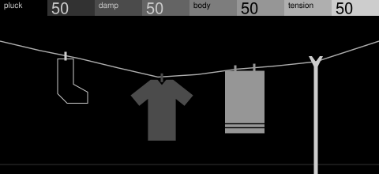

1. **Subject:** a washing line. A plucked string is a line under tension, and that's the
   whole joke.
2. **Way of drawing:** line diagram with small flat garments. The line enters at the left
   edge and leaves at the right.
3. **Grey code:** left to right along the line: hollow sock, dark shirt, mid towel, light
   prop.
4. **Controls:** pluck slides the sock along the line. Damp makes the shirt bigger and
   heavier, so the line dips under it. Body lengthens the towel. Tension raises the prop,
   which pulls the line straight.
5. **Notes:** a note plucks the line. It swings and settles, longer for a held note and
   quicker as damp rises.
6. **Check:** at 1:1 it reads as a washing line, and no two controls move in the same way.
   Tension is the expensive one, at 20 changed nodes while it turns.

## More examples

Original screens drawn to these rules within a machine's limits, each for a different
kind of sound. They're designs rather than built machines: their motion is described, so
the stock engines remain the better reference for animation.

### CD player

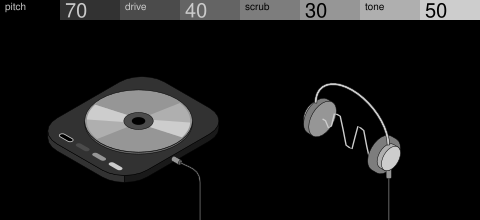

**Sample player.** A shiny disc, and the wave it plays in a pair of headphones.

- **Drawing:** isometric with a flat companion. A thin deck with very round corners and a
  light strip along its front sides; a silver disc on a short spindle, with a clear ring
  round the hole and a bow of light across it, a dimmer smear trailing each wedge. Beside
  it, a pair of wire-band headphones head on, with the wave they play running from the
  middle of one pad to the other. A cord leaves a plug on the deck's side, drops off the
  bottom of the screen and comes back up into the left cup.
- **Grey code:** four flush pills along the deck's front edge.
- **Controls:** pitch sets how many cycles cross between the pads, and past halfway swaps
  the disc from a mini 8 cm to a full 12 cm, two fixed sizes rather than a scaled one.
  Drive clips the wave toward a square. Scrub turns the bow of light and slides the wave
  along. Tone adds a harmonic, so the wave's sides steepen.
- **Notes:** the bow of light spins fast, its smear trailing it, and the wave scrolls while
  a note is held; both coast to a stop after the release.
- **To borrow:** a swap between fixed sizes in place of scaling a 3D part; a flat highlight
  with a dim smear for speed, on a 3D object that never turns; the graph set inside the
  scene, between the pads, rather than on a plate; a cord that leaves the frame to join
  two things.

### Office blinds

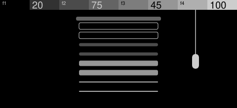

**Formant bank.** Each blind lets through more or less of one band.

- **Drawing:** one blind and nothing else: a rail, eight thick rounded slats in four pairs,
  and a large white pull cord hanging into view from above.
- **Grey code:** one slat pair per encoder, top to bottom.
- **Controls:** each of f1 to f4 tilts its pair open, so the slats thin toward a hairline.
- **Notes:** the slats flutter a little further open while a note is held.
- **To borrow:** subtraction: no frame, no tassel, no second blind.

### Sliding slabs

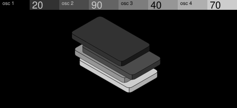

**Four oscillators.** Layers of the same thing, shifted against each other.

- **Drawing:** isometric: four thin slabs with rounded corners and even gaps, and no
  subject at all.
- **Grey code:** top to bottom, dark to light.
- **Controls:** each control slides its slab along one axis.
- **Notes:** a note lifts the gaps open a little, and they close as it fades.
- **To borrow:** no subject, just layers shifted against each other.

### Wave and ball

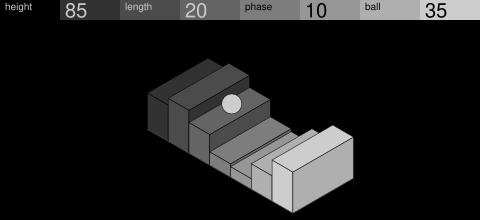

**Wavetable.** A wave you could roll something along.

- **Drawing:** isometric: a row of solid bars whose heights hold one wave, dark to light,
  with a plain light ball on top.
- **Grey code:** the ramp runs along the bars; the ball takes the lightest grey.
- **Controls:** height and length shape the wave, phase moves it along, and ball rolls the
  ball across it.
- **Notes:** the wave travels along the bars while a note is held, carrying the ball.
- **To borrow:** one round thing riding a field of straight ones.

### Cube ring

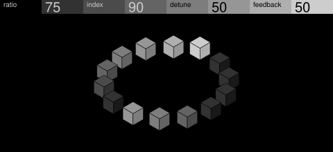

**FM pair.** Something running round a loop, with a tail behind it.

- **Drawing:** isometric: fourteen small cubes on a circle. A lit cube fades through the
  ramp to near black behind it, and a second, shorter tail sits across the ring.
- **Grey code:** the fade replaces it, as a position rather than an encoder.
- **Controls:** run moves the lit cube, tail sets how far the fade reaches, offset moves
  the second tail, and lift raises the lit cube off the ring.
- **Notes:** a note sets the lit cube running round the ring; after the release it coasts
  back to where run puts it.
- **To borrow:** a fade standing in for the grey code.

### Checkerboard

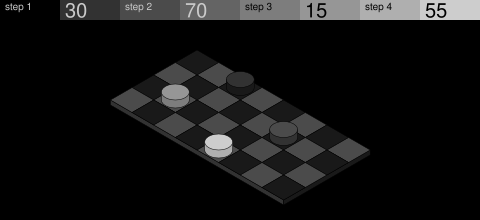

**Step sequence.** Four steps, each picking a note from a row.

- **Drawing:** isometric: one thin checked board with round pieces on it, the first
  hollow.
- **Grey code:** one piece per lane.
- **Controls:** each control moves its piece along its lane a square at a time.
- **Notes:** the piece for the step that plays hops up and lands back.
- **To borrow:** a board as a grid of lanes, one piece per encoder.

### Rotary phone

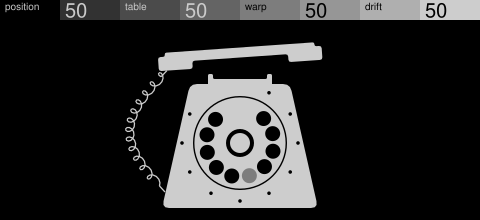

**Stepped wavetable.** Dialling is choosing from a fixed row of numbers.

- **Drawing:** dead-front silhouette in `CDCDCD`, every corner rounded, with small black
  dots for the dial's numbers.
- **Grey code:** none. Four different movements do its work, and one mid-grey hole marks
  the current table.
- **Controls:** position turns the wheel. Table moves the mark to another hole. Warp lifts
  and tilts the handset. Drift swings the coiled cord out.
- **Notes:** a note winds the dial a little way and lets it run back; a held note winds it
  further.
- **To borrow:** four different movements in place of the grey code; dots for numbers.

### Music box

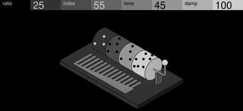

**Bell.** The little hand-cranked mechanism.

- **Drawing:** isometric: a pinned cylinder, a comb of teeth running long to short, a
  stand and a small crank.
- **Grey code:** the cylinder's four bands, hollow then dark to light.
- **Controls:** each control adds pins to its band, one to eight. Pin count is hard to
  see, so it's the weakest here against [every control reads](ux.md#screens): check
  it on a device.
- **Notes:** the cylinder and crank turn while a note sounds, and the struck tooth flicks.
- **To borrow:** the mechanism as the picture; a control that adds parts.

### Pendulums

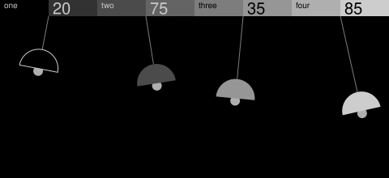

**Four-voice pad.** Four voices drifting in and out of step.

- **Drawing:** half discs on thin rods hanging from the header's stepped bar, each rod a
  little longer than the last, as in a pendulum wave.
- **Grey code:** left to right, one shade each.
- **Controls:** each sets its pendulum's resting angle.
- **Notes:** a note swings them, the longer ones slower so they drift apart.
- **To borrow:** the header bar used as part of the scene (on a four-control screen,
  where the header stays put).

### How they compare

Nodes count everything drawn below the header. The last column is the most nodes that
change in one 5% step of a single control, from a script sweeping each control; it's not
a device measurement. Peaks above 20 are fine while a control turns, but not as the
average while notes sound.

| Example | Way of drawing | Grey code | Nodes | Most changed |
| --- | --- | --- | --- | --- |
| Washing line | Line and flat shapes | Along the line | 21 | 20 |
| CD player | Isometric and flat shapes | Pills | 30 | 5 |
| Office blinds | Flat shapes | Slat pairs | 11 | 2 |
| Sliding slabs | Isometric | Whole slabs | 12 | 3 |
| Wave and ball | Isometric | Ramp, then the ball | 24 | 22 |
| Cube ring | Isometric | Fade | 42 | 24 |
| Checkerboard | Isometric | Pieces | 42 | 2 |
| Rotary phone | Silhouette | None | 33 | 10 |
| Music box | Isometric | Bands | 47 | 1 |
| Pendulums | Flat shapes | Whole shades | 12 | 3 |
| Barcode | Rule field | Dots | 78 | 9 |
| Threshold | Rule field | Tiles | 256 | 4 |
| Split | Rule field | Quarters | 88 | 22 |
| Spokes | Rule field | None | 61 | 60 |
| Truchet | Rule field | Column groups | 224 | 10 |
| Gravel | Rule field | Column groups | 72 | 18 |
| Halftone | Rule field | None | 198 | 62 |

## Rule fields

Seven fields, each a rule a machine could run, with what a note might do to it.

### Barcode

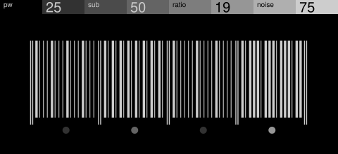

**Rhythm, printed.** Four Euclidean rhythms of sixteen steps, set as a barcode.

- **Drawing:** four sections between guard bars that drop below the rest. Every step is a
  bar, wide for a hit and thin for a rest, all in one light ink, with a status dot under
  each section.
- **Grey code:** only the dots carry it, so the barcode stays one ink.
- **Controls:** each sets its section's hits; a turn only widens or narrows bars.
  *Notes:* thicken the bar that plays for a moment, like a scanner passing.

### Threshold

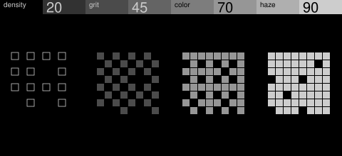

**Grain or noise density.** Ordered dither, the textures between empty and full.

- **Grey code:** four tiles of one threshold map, hollow then dark to light.
- **Controls:** each fills its tile to a level. *Notes:* lift a level for a moment, so the
  texture blooms and settles.

### Split

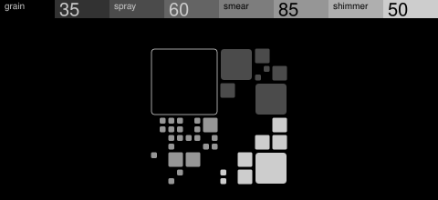

**Granular or spectral.** A square divided again and again into quarters, with only some
of the cells drawn, as rounded tiles, so the splits show as sizes.

- **Why it works:** it reads vaguely as a close-up of a processor's die without drawing
  one. A package, pins or a floorplan in outlines would make it literal and weaker.
- **Grey code:** one quarter per encoder.
- **Controls:** each sets how far its quarter subdivides. *Notes:* show a few more tiles
  for a moment, like activity on a chip.

### Spokes

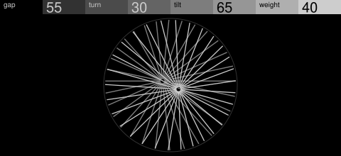

**Phase.** Two fans of spokes in one round window, with their hubs pulled apart.

- **Grey code:** none. One fan is dim, the other light, and the bands come from the pair.
- **Controls:** gap and tilt move the second hub, turn rotates its fan and weight
  thickens it. *Notes:* kick the fan round a few degrees.
- **Building it:** the picture trims each spoke to the window, which a frame can't do.
  Build it from full-length spokes that only move and turn, under a fixed black mask
  with a round hole.

### Truchet

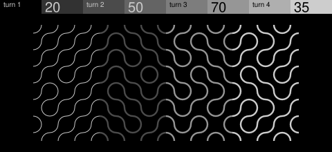

**Random or sample and hold.** Quarter-arc tiles turned one way or the other, so rows of
waves break into loops.

- **Grey code:** four column groups, the first in thin light lines.
- **Controls:** each turns more of its group's tiles. *Notes:* turn a few at random.

### Gravel

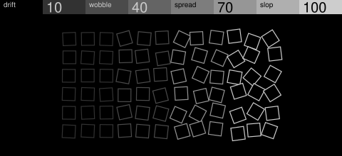

**Drift.** A neat grid of hollow squares that loosens.

- **Grey code:** four column groups, the first in light lines.
- **Controls:** each sets how loose its group is, every square keeping its own way of
  moving. *Notes:* shake a column loose for a moment.

### Halftone

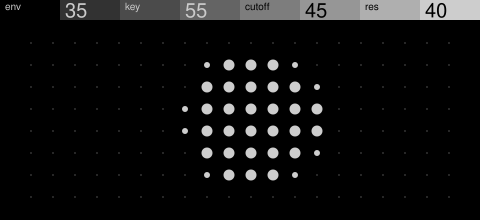

**Filter or envelope.** A field of dots that swell into a soft round spot.

- **Grey code:** none; the dots are all light.
- **Controls:** x and y move the spot, size and edge shape it. *Notes:* swell it like a
  flash. A turn changes dozens of dots at once, so a device needs fewer, larger
  ones.

## Where stock breaks its own rules

Stock isn't uniform, and the look survives it. Hardsync's hero ignores the code and leaves
it to its graph. Organ doesn't move with notes and is little more than four tiles.
Wavetable ships no art at all, and the official renders of simple, axis and organ show no
stepped header. Treat this page as a way into the look, and break it once you know why.
